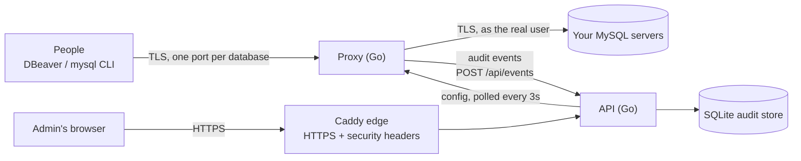

# Lustre — Handover to Acumen Software

This is the starting point for anyone at Acumen picking up Lustre, the MySQL auditing proxy
built by Team Lustre (Stellenbosch University, CS344/RW344, July–October 2026). It covers what
the system does, how to run it, what to change before it goes anywhere near production, what it
does not do, and where to look in the code.

Status at handover: **v1.0, as demonstrated on 16 October 2026.** Everything below describes the
`main` branch at that point.

> **Ownership and licence:** to be confirmed with Stellenbosch University before the code is
> released to Acumen. Until then, treat this repository as not yet licensed for use.

---

## 1. What it is

Acumen's developers shared database logins, so nothing in MySQL could be attributed to a person.
Lustre sits in front of your MySQL servers. People connect their usual tools (DBeaver, the
`mysql` CLI, JDBC) to the proxy instead of the database, and it records **who ran what, when,
and against which server**, without changing how they work.

- **Each user reaches MySQL as themselves.** The proxy holds no user passwords. It logs in with
  a bootstrap account that can do nothing, asks MySQL to switch the connection to the connecting
  user (`COM_CHANGE_USER`), and relays MySQL's own password challenge to the client. MySQL
  authenticates the user and enforces their grants.
- **Everything is audited.** Every connection, statement and failed login becomes an event,
  stored in an audit log.
- **The audit log comes first.** If auditing falls behind under load, queries wait rather than
  records being dropped (configurable).
- **Several databases, one proxy.** Each configured server gets its own listening port.
- **A back-office** (web UI over HTTPS) to search the log, manage which databases the proxy
  fronts — changes apply live, without a restart — and manage admin accounts.
- **Encrypted on both legs.** Clients must use TLS to the proxy; the proxy always uses TLS
  (1.2+) to MySQL and verifies the certificate by default.

## 2. Architecture in one page



| Component | Code | What it does |
|---|---|---|
| Proxy | `cmd/proxy`, `internal/proxy/*`, `internal/passthrough`, `internal/upstream` | Accepts client connections, passes logins through to MySQL, forwards SQL, emits audit events, reconciles its listeners when config changes |
| Audit sink | `internal/sink` | In the proxy: queues events (1,024), batches them (50 / 1 s) and POSTs them to the API with a service token |
| API | `cmd/api`, `internal/api` | Ingests events, serves search, serves config to the proxy, admin accounts and sessions |
| Store | `internal/store`, `internal/retention` | SQLite (WAL); idempotent writes; optional retention job |
| Back-office | `web/` | Plain JavaScript (ES modules, no build step) |
| Edge | `deploy/Caddyfile`, `deploy/Dockerfile.edge` | Serves the UI, forwards only the browser's API paths, HTTPS and a strict CSP |
| Shared contract | `internal/audit` | The event and server types both halves are built against |

The decisions behind this are recorded in `docs/design/decisions/` (see §8).

## 3. Running it locally

Requires Docker, and Go 1.26+ for the tests.

```bash
make up        # builds and starts everything; first run creates deploy/.env from the template
make routes    # proves :3307 reaches db-a and :3308 reaches db-b
make mysql-a   # a MySQL shell through the proxy as alice (db-a)
make mysql-b   # ... as bob (db-b)
make ui        # opens https://localhost — log in as admin / admin123 (development only)
make logs      # follow proxy and API logs
make down      # stop (data kept); `docker compose -f deploy/docker-compose.yml down -v` wipes it
```

The development stack runs two sample databases (`db-a` with a `sales` schema, `db-b` with
`hr`), seeded with real per-user accounts: `alice` (db-a), `bob` (db-b) and a `proxy_bootstrap`
account on each with `USAGE` only. Passwords are in `deploy/.env`.

To try it with DBeaver: host `127.0.0.1`, port `3307` or `3308`, SSL on, **certificate
verification off** (the proxy's client-facing certificate is self-signed), driver properties
`sslMode=REQUIRED` and `useServerPrepStmts=true`.

> **Connect to 3307 and 3308, never 3306 or 3316.** Those are the sample databases' own ports,
> published for development. A client on them bypasses the proxy and nothing is audited.

Full detail: `deploy/README.md`.

## 4. Deploying it at Acumen

The compose file is a development stack. A production deployment needs the following; none of
it is optional.

### 4.1 Database side

1. **Enable TLS on every MySQL server** the proxy will front, with a certificate from your CA
   whose SAN matches the hostname the proxy will use. The proxy refuses a server without TLS;
   there is no plaintext fallback.
2. **Give every person their own MySQL account** with the grants they should have.
   Use `caching_sha2_password` (MySQL 8's default). Accounts still on `mysql_native_password`
   cannot be reached from MySQL 9 clients, which removed that plugin.
3. **Create a bootstrap account on each server** for the proxy, with `GRANT USAGE ON *.*`
   only. It must be able to log in and nothing else. The proxy never needs root.
4. **Make MySQL reachable only from the proxy** (firewall, security group or private network),
   or require client certificates on user accounts (`REQUIRE X509`). Otherwise anyone with a
   password can connect directly and leave no audit record. This is the single most important
   operational control.
5. Check `max_connections` covers your peak concurrent users: each client session holds one
   upstream connection (no pooling, by design).

### 4.2 Lustre side

1. **Replace every development secret** in `deploy/.env` — the table in `deploy/README.md`
   ("Secrets") lists each one and how to generate it. In particular `API_ADMIN_PASS_HASH`
   (the dev password is `admin123`), `API_CONFIG_KEY` (32 characters; encrypts stored
   bootstrap passwords — changing it later orphans them), `API_PROXY_TOKEN`.
2. **Configure your servers** in the back-office (Servers screen): name, listen port, upstream
   host and port, the bootstrap account and password, and TLS. `deploy/upstreams.json` only
   seeds the server list on a fresh database; after that the back-office is the source of
   truth.
3. **Use `tls: verify`** for every server, and mount your CA bundle (public certificates only)
   read-only into the proxy container, setting `tls_ca_file` to its path. The sample config
   uses `skip-verify` only because stock MySQL generates untrusted certificates; `skip-verify`
   still encrypts but does not check identity. See `deploy/README.md` → "Mandatory upstream
   TLS". `make test-tls` demonstrates `verify` against CA-signed databases.
4. **Set `SITE_ADDRESS`** to the back-office's real domain. Caddy then obtains and renews a
   certificate automatically (needs DNS and ports 80/443).
5. **Publish only the proxy ports and the edge.** The API (8080) and the proxy's admin port
   (9100) must stay internal.
6. **Decide retention** (§6) and set `API_RETENTION_DAYS` if you want old records removed.
7. **Back up the `api-data` volume.** It holds the audit log, the server list and the admin
   accounts.

### 4.3 Configuration reference

| Where | Key settings | Documented in |
|---|---|---|
| Secrets | DB, bootstrap, admin hash, config key, proxy token | `deploy/README.md` → Secrets |
| Proxy | `API_URL`, `API_PROXY_TOKEN`, `PROXY_ADMIN_ADDR`, `PROXY_DRAIN_TIMEOUT` (30 s), `PROXY_UPSTREAM_READ_TIMEOUT` (60 s), `PROXY_COMMAND_TIMEOUT` (off), `SINK_ON_FULL` (`block`) | `cmd/proxy/README.md` |
| API | `API_CONFIG_KEY`, `API_PROXY_TOKEN`, `API_ADMIN_PASS_HASH` (first boot only; the first admin is named `admin` — compose does not pass `API_ADMIN_USER` through, so add it there to choose another name), `API_RETENTION_*` | `deploy/README.md` |
| Edge | `SITE_ADDRESS` | `deploy/README.md` → The edge |

## 5. Operating it

| Task | How |
|---|---|
| Add, change or remove a database | Back-office → Servers. The proxy picks it up within a few seconds; the screen shows when it is applied. Sessions on a moved or removed port get up to 30 s to finish |
| Add a user | Create the MySQL account and grants on the database. Nothing to do in Lustre |
| Revoke a user | Revoke or lock in MySQL. It takes effect on their next connection |
| Add a back-office admin | Back-office → Admins (any admin can) |
| Locked out of the back-office | No reset flow: update the `admins` table directly (see `deploy/README.md` → Back-office Administrator Accounts) |
| Rotate the bootstrap password | Change it in MySQL, then re-enter it on the Servers screen |
| Check health | Proxy `GET :9100/healthz` and `GET :9100/metrics` (Prometheus text) |
| Watch for audit loss | `lustre_audit_failed_total` and `lustre_audit_dropped_total` should stay at 0; `lustre_audit_queue_depth` near 0 |
| Reseed the dev stack | `docker compose -f deploy/docker-compose.yml down -v`, then `make up` |

**Metrics exist but nothing consumes them yet.** Point Prometheus (or your monitoring) at the
proxy's admin port and alert on the failed/dropped counters.

## 6. Decisions left to Acumen

These were raised during the project and are yours to make:

| Decision | Current default | Our recommendation |
|---|---|---|
| **Retention** — how long to keep audit records, delete or archive | Off: everything kept forever (~362 bytes per statement) | 365 days, delete. Try `API_RETENTION_DRY_RUN=true` first. ADR 0006 |
| **Masking literal values** in stored SQL (POPIA) | Raw SQL stored, literals included. Prepared statements store `?` placeholders only | Store a normalised fingerprint for search, with raw text under tighter access. Not built |
| **SQLite or Postgres** | SQLite | Stay on SQLite until you need more than one API instance, high availability, or ~100 GB of retained data. ADR 0007 |
| **Block or drop** when auditing falls behind | `block` (audit first; your choice at the Sprint 2 demo) | Keep `block` |

## 7. Known limitations

The full, current list is `docs/known-limitations.md`. The ones that matter most for running it:

- **Delivery is not durable.** Blocking protects against a *slow* audit pipeline. If the API is
  *down*, each batch is retried for ~15 s and then dropped (counted in
  `lustre_audit_failed_total`). Events still in the proxy's memory when it stops are also lost.
  A disk buffer is the fix.
- **Not tamper-evident.** The audit log is a SQLite file; someone with access could edit it.
- **Bypass is possible** unless MySQL is network-restricted to the proxy (§4.1.4).
- **The client-facing certificate is self-signed** and regenerated on every proxy start, so
  clients cannot verify the proxy's identity.
- **Single instance.** One proxy, one API, one SQLite file; no failover.
- **Result sets are buffered in memory**, so a very large `SELECT` costs proxy memory.
- **Failed prepared statements report error 1105** instead of the real MySQL code (a go-mysql
  defect; the real code is in the message).
- **One admin role**, no MFA, fixed 24-hour sessions.
- **Free-text search is a table scan** — fine at demo scale, slow at millions of rows.

## 8. Design decisions (ADRs)

`docs/design/decisions/`:

| ADR | Decision |
|---|---|
| 0001 | Go for the proxy |
| 0002 | go-mysql on both the client-facing and database-facing halves |
| 0003 | The proxy POSTs events to the API; the API is the only writer to the store |
| 0004 | Pass-through authentication via `COM_CHANGE_USER` on a bootstrap connection |
| 0005 | The audit sink blocks by default when its buffer is full (supersedes 0003's "never block") |
| 0006 | Retention is configurable and off by default; 365 days recommended |
| 0007 | SQLite remains the audit store |

The spikes behind ADR 0004 are in `docs/design/spikes/`.

## 9. Performance

Measured on one laptop (Apple M4, MySQL in Docker) — the differences transfer, the absolute
numbers do not. Full detail in `docs/perf/`.

| Measure | Result |
|---|---|
| Added latency per query at 25–50 connections | ~1–4 ms |
| Audit completeness at the specified load (~2,500 statements/s) | No loss, in either mode |
| Block-mode ceiling | ~18,500 statements/s (~7× the specified load); beyond that, queries are slowed rather than records lost |
| Added cost per new connection | ~2.2 ms (the per-user login), once per session |

## 10. Testing and CI

- `make test` — unit and integration tests (integration tests run against a real MySQL 8.0)
- `make test-e2e` — builds the real binaries and drives them against two databases
- `make test-tls` — TLS acceptance stack (CA-signed and TLS-disabled databases)
- `make web-test` — UI helper tests (Node 22+)
- `make perf` — performance measurements (not pass/fail)
- `make lint` — gofmt and go vet

About 290 Go tests. The GitLab pipeline (`.gitlab-ci.yml`) runs lint → test → e2e on every
push; integration and e2e tests **fail rather than skip** if a database is missing. Port it to
your CI as-is. `docs/testing.md` explains the approach.

**Rules the team followed, worth keeping:** every bug fix ships with a regression test verified
failing first; never wrap errors returned by go-mysql's `Execute` (they collapse to 1105); never
put upstream connections in a pool (`internal/passthrough/nopool_test.go` enforces this).

## 11. Where to start in the code

1. `docs/design/decisions/0004-pass-through-authentication.md` — the core design.
2. `internal/proxy/runtime/session.go` — one client session, start to finish.
3. `internal/passthrough/` — the login relay (`provider.go`, `changeuser.go`, `relay.go`).
4. `internal/proxy/runtime/handler.go`, `handler_stmt.go` — queries and prepared statements.
5. `internal/proxy/runtime/manager.go`, `reconciler*.go` — live configuration.
6. `internal/sink/sink.go` → `internal/api/api.go` → `internal/store/store.go` — the audit path.
7. `docs/known-limitations.md` → "Traps in the code" before changing anything.

## 12. Suggested next work

In order of value:

1. **Durable audit buffer** — spool events to disk in the proxy so an API outage loses nothing.
2. **Monitoring** — scrape `/metrics`, alert on failed/dropped events and proxy health.
3. **Tamper-evident records** — hash-chain statement rows.
4. **Masking / fingerprinting** literal values, once the POPIA decision is made.
5. **A configurable client-facing certificate**, so clients can verify the proxy.
6. **Graceful shutdown** for the proxy (drain sessions and the audit buffer on SIGTERM).
7. **Login rate limiting on the proxy** — each attempt costs MySQL a TLS connection and login.
8. **Streaming result sets** instead of buffering them.

## 13. Contacts

Team Lustre (Stellenbosch University, 2026):

| Area | Person |
|---|---|
| Coordination, infrastructure, integration | Tate Evans |
| Proxy | Joe Mudge, Mieke Wepener |
| Store and API | Keagan Slabbert |
| Back-office UI and audit sink | Maria Kotze |

Support is provided as-is. We are happy to run a handover session with your team and to answer
questions for a short period after the project closes; contact Tate Evans to arrange it.
