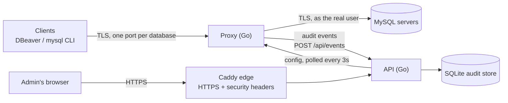

# MySQL Audit Proxy

A MySQL **auditing proxy**. It sits between database clients (the `mysql` CLI, DBeaver, JDBC
applications) and your MySQL servers, relays traffic transparently, and records **who ran
what, when, and against which server**. A web back-office lets an administrator search the
audit log, manage which databases the proxy fronts, and manage admin accounts.

It exists for the common case where people share database logins, so nothing in MySQL can be
attributed to a person. Here every person connects as themselves and every connection,
statement and failed login is recorded.

## Features

- **Each user reaches MySQL as themselves.** The proxy holds no user passwords. It logs in with
  a bootstrap account that can do nothing, asks MySQL to switch the connection to the
  connecting user (`COM_CHANGE_USER`), and relays MySQL's own password challenge to the client.
  MySQL authenticates the user and enforces their grants.
- **Everything is audited.** Every connection, statement and failed login becomes an event in
  the audit log.
- **The audit log comes first.** If auditing falls behind under load, queries wait rather than
  records being dropped (configurable with `SINK_ON_FULL`).
- **Several databases, one proxy.** Each configured server gets its own listening port, and
  changes apply live without a restart.
- **Encrypted on both legs.** Clients must use TLS to the proxy. The proxy uses TLS (1.2+) to
  MySQL and verifies the certificate by default.
- **A back-office.** A web UI over HTTPS to search the log, manage servers and admins, with named
  admin accounts, cookie sessions, login rate limiting and an attribution log of admin actions.
- **Optional retention.** Delete or archive old audit records on a schedule.

## How it works



See [docs/architecture.md](docs/architecture.md) for the components and the decisions behind them.

## Tech stack

- **Proxy:** Go, using the `go-mysql` library for the MySQL wire protocol
  ([ADR 0001](docs/design/decisions/0001-proxy-language.md)).
- **Audit store:** SQLite ([ADR 0007](docs/design/decisions/0007-sqlite-remains-the-audit-store.md)).
- **Back-office:** a Go API plus a plain JavaScript front-end (no build step, no framework),
  served over HTTPS by Caddy.

## Getting started

Requires Docker and Go 1.26+.

```bash
make up          # build and start two sample databases, a proxy for each, and the API
                 # (the first run creates deploy/.env with development secrets)
make routes      # check each proxy port reaches its own database
make logs        # follow proxy and API output
```

Then drive it:

```bash
# A client session through each proxy: the port picks the database. You log in as a real
# database user (alice on db-a, bob on db-b; passwords in deploy/.env), and the database
# checks the password, not the proxy.
make mysql-a   # shell on db-a as alice
make mysql-b   # shell on db-b as bob

# the back-office UI and API, served by the edge (self-signed certificate: -k)
curl -sk https://localhost/healthz
make ui        # opens https://localhost
```

**Back-office login (local development only):** `admin` / `admin123`. This is the development
credential from `deploy/.env.example`. It is public, so never use it anywhere but your own
machine. To replace it, generate a new bcrypt hash and set `API_ADMIN_PASS_HASH` in
`deploy/.env`:

```bash
htpasswd -nbBC 10 "" 'the-new-password' | cut -d: -f2
```

(`API_ADMIN_USER` sets the username; it defaults to `admin`. See
[`deploy/README.md`](deploy/README.md) for every secret.)

To try it with DBeaver: host `127.0.0.1`, port `3307` or `3308`, SSL on, **certificate
verification off** (the proxy's client-facing certificate is self-signed).

> **Connect to 3307 and 3308, never 3306 or 3316.** Those are the sample databases' own ports,
> published for development. A client on them bypasses the proxy and nothing is audited.

`make down` stops the stack; `make help` lists the rest.

## Layout

| Path | What |
|---|---|
| `cmd/proxy` | entry point for the auditing proxy |
| `internal/proxy/app`, `internal/proxy/config`, `internal/proxy/runtime` | proxy startup, configuration and runtime, with colocated tests |
| `internal/passthrough`, `internal/upstream` | the login relay and the database-facing connection |
| `cmd/api` | the back-office API |
| `internal/audit` | the shared `Event` type and `Sink` interface, the contract both halves code against |
| `internal/sink` | implementations of `audit.Sink` |
| `internal/api`, `internal/store` | API handlers and the SQLite audit store |
| `internal/retention` | the optional audit-log retention job |
| `web` | the back-office UI (static files, served by the edge; see [`web/README.md`](web/README.md)) |
| `e2e` | end-to-end tests and the performance harness (need the compose stack) |
| `deploy` | Dockerfiles, compose stack, Caddy edge configuration |

For the proxy's file-by-file layout and test locations, see the
[proxy source guide](cmd/proxy/README.md#source-layout).

## Working on it

```bash
make test        # all tests; proxy integration tests need the db container, the UI helpers need node 22
make test-e2e    # builds the real binaries and drives them against two databases
make web-test    # just the UI helpers' tests
make csp-check   # fail if web/ has inline scripts or styles the CSP would block
make lint        # gofmt + go vet, same as CI
make perf        # performance measurements: not pass/fail
```

See [CONTRIBUTING.md](CONTRIBUTING.md) for the branch and pull request workflow.

## Documentation

| Document | What it covers |
|---|---|
| [Architecture](docs/architecture.md) | components, how a request flows, where to start in the code |
| [Deploying and operating](docs/operations.md) | what a production deployment needs, day-to-day operation, configuration |
| [Deployment guide](deploy/README.md) | the compose stack, secrets, TLS, the edge |
| [Proxy guide](cmd/proxy/README.md) | proxy configuration, source layout, behaviour |
| [Back-office UI](web/README.md) | the front-end structure |
| [Data model and API](docs/design/data-model.md) | tables, endpoints and event shapes |
| [Architecture decisions](docs/design/decisions/) | ADRs recording the key choices, and [spikes](docs/design/spikes/) behind them |
| [Testing](docs/testing.md) | how the system is tested and how to build for testability |
| [Performance](docs/perf/block-mode-rerun.md) | current measurements, and the [initial baseline](docs/perf/baseline.md) |
| [Known limitations](docs/known-limitations.md) | what it does not do, the traps in the code, and possible next work |
