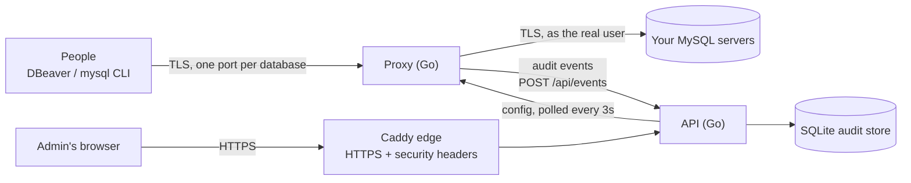

# Architecture

The system has two services that share one audit store: the **proxy** (the data path), which
relays MySQL traffic and records audit events, and the **back-office** (the control plane), which
lets an administrator review the log and manage configuration.

## Components

| Component | Code | What it does |
|---|---|---|
| Proxy | `cmd/proxy`, `internal/proxy/*`, `internal/passthrough`, `internal/upstream` | Accepts client connections, passes logins through to MySQL, forwards SQL, emits audit events, reconciles its listeners when config changes |
| Audit sink | `internal/sink` | In the proxy: queues events (1,024), batches them (50 / 1 s) and POSTs them to the API with a service token |
| API | `cmd/api`, `internal/api` | Ingests events, serves search, serves config to the proxy, admin accounts and sessions |
| Store | `internal/store`, `internal/retention` | SQLite (WAL); idempotent writes; optional retention job |
| Back-office | `web/` | Plain JavaScript (ES modules, no build step) |
| Edge | `deploy/Caddyfile`, `deploy/Dockerfile.edge` | Serves the UI, forwards only the browser's API paths, HTTPS and a strict CSP |
| Shared contract | `internal/audit` | The event and server types both halves are built against |

The decisions behind this are recorded in [`docs/design/decisions/`](design/decisions/) (see below).

## How a request flows

1. A client connects to the **proxy** on a port. Each port maps to one upstream database.
2. The proxy terminates the client's TLS, opens its own TLS connection to the database as the
   **bootstrap** account, then asks the database to switch that connection to the connecting
   user and relays the database's password challenge to the client. The database authenticates
   the user ([ADR 0004](design/decisions/0004-pass-through-authentication.md)).
3. Statements are forwarded to the database and the results returned. Each connection,
   statement and failed login becomes an **audit event** handed to the **sink**.
4. The sink batches events and POSTs them to the **API**, which is the only writer to the store
   ([ADR 0003](design/decisions/0003-audit-write-path.md)). When the sink's buffer is full the
   proxy waits by default rather than dropping events
   ([ADR 0005](design/decisions/0005-audit-sink-blocks-by-default.md)).
5. An administrator uses the **web UI**, served through the **edge**, to search the log and manage
   servers. The proxy polls the API for its configuration and reconciles its listeners when it
   changes, touching only new, changed or removed ports.

## Design decisions

Recorded in [`docs/design/decisions/`](design/decisions/):

| ADR | Decision |
|---|---|
| 0001 | Go for the proxy |
| 0002 | go-mysql on both the client-facing and database-facing halves |
| 0003 | The proxy POSTs events to the API; the API is the only writer to the store |
| 0004 | Pass-through authentication via `COM_CHANGE_USER` on a bootstrap connection |
| 0005 | The audit sink blocks by default when its buffer is full (supersedes 0003's "never block") |
| 0006 | Retention is configurable and off by default; 365 days recommended |
| 0007 | SQLite remains the audit store |

The investigations behind ADR 0004 are in [`docs/design/spikes/`](design/spikes/).

## Performance

Measured on one laptop (Apple M4, MySQL in Docker) — the differences transfer, the absolute
numbers do not. Full detail in [`docs/perf/`](perf/block-mode-rerun.md).

| Measure | Result |
|---|---|
| Added latency per query at 25–50 connections | ~1–4 ms |
| Audit completeness at a load of ~2,500 statements/s | No loss, in either mode |
| Block-mode ceiling | ~18,500 statements/s (~7× that load); beyond that, queries are slowed rather than records lost |
| Added cost per new connection | ~2.2 ms (the per-user login), once per session |

## Where to start in the code

1. `docs/design/decisions/0004-pass-through-authentication.md` — the core design.
2. `internal/proxy/runtime/session.go` — one client session, start to finish.
3. `internal/passthrough/` — the login relay (`provider.go`, `changeuser.go`, `relay.go`).
4. `internal/proxy/runtime/handler.go`, `handler_stmt.go` — queries and prepared statements.
5. `internal/proxy/runtime/manager.go`, `reconciler*.go` — live configuration.
6. `internal/sink/sink.go` → `internal/api/api.go` → `internal/store/store.go` — the audit path.
7. `docs/known-limitations.md` → "Traps in the code" before changing anything.

## Conventions worth keeping

- Every bug fix ships with a regression test verified failing first.
- Never wrap errors returned by go-mysql's `Execute`; they collapse to error 1105.
- Never put upstream connections in a pool (`internal/passthrough/nopool_test.go` enforces this).
