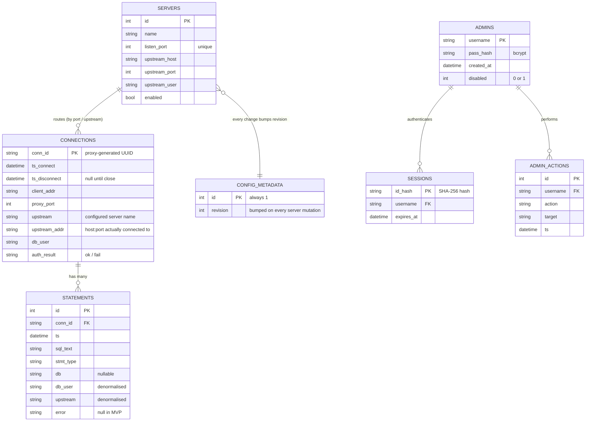
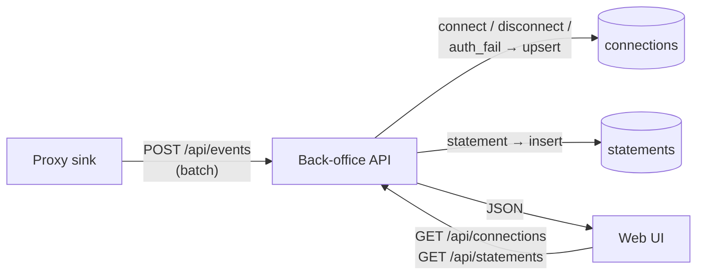

# Data Model & API Contract — Sprint 1

**Owner:** Keagan · **Status:** CONFIRMED (2026-08-12) · **Scope:** Sprint 1 MVP

This is the contract the proxy, audit sink, back-office API, and UI all code against.

Conventions:
 - JSON everywhere;
 - timestamps ISO-8601 UTC with 6-digit fractional seconds (e.g., `2026-08-13T12:00:00.100000Z`);
 - ids are strings unless noted;
 - errors returned as `{"error":"..."}` with an appropriate HTTP status.

## Confirmed decisions
1. **`conn_id` is generated by the proxy** (UUID) so events are self-contained and can reference a connection before its row exists.
2. **`db_user` and `upstream` are denormalised onto `statements`** so the UI can filter without a join (tiny duplication, simpler queries).
3. **`servers` is mutable via the API** and supports live-reloading through configuration polling.
4. **Connections record both `upstream` (the configured server name) and `upstream_addr` (the `host:port` actually connected to).** The name is what the UI filters and groups by, and is the logical link to `servers`. The address is what the audit trail needs: a name is a mutable indirection, so if a server is later repointed in config, every historical row carrying only the name would silently describe something that is no longer true. Only `upstream` is denormalised onto `statements` — the address is reachable via `conn_id` and is not something the UI filters on.

## Data model



> `SERVERS → CONNECTIONS` is a **logical** link (a connection's `upstream` / `proxy_port` correspond to a configured server) — not an enforced foreign key in the MVP, since `servers` is config-driven. The only real FK is `statements.conn_id → connections.conn_id`.

### `connections` — one row per client connection
| Column | Type | Notes |
|--------|------|-------|
| `conn_id` | string (PK) | proxy-generated UUID |
| `ts_connect` | datetime, null | A disconnect or auth_fail can create the row before connect arrives |
| `ts_disconnect` | datetime, null | set on disconnect |
| `client_addr` | string | `ip:port` |
| `proxy_port` | int | which listen port |
| `upstream` | string | configured server name (logical link to `servers.name`) |
| `upstream_addr` | string | `host:port` actually connected to, as resolved at connect time |
| `db_user` | string | username from the handshake |
| `auth_result` | string | `ok` / `fail` |
| `auth_fail_reason` | string, null | the auth_fail event's `err` text; set only for a rejected login, null otherwise |

### `statements` — one row per query
| Column | Type | Notes |
|--------|------|-------|
| `id` | int (PK, auto) | |
| `conn_id` | string (FK → connections) | |
| `ts` | datetime (UTC) | |
| `sql_text` | text | raw SQL |
| `stmt_type` | string | SELECT/INSERT/… best-effort |
| `db` | string, null | schema in use |
| `db_user` | string | denormalised from the connection |
| `upstream` | string | denormalised from the connection |
| `error` | string, null | null in MVP |

### `servers` — routing configuration
| Column | Type | Notes |
|--------|------|-------|
| `id` | int (PK) | |
| `name` | string | friendly id |
| `listen_port` | int | unique |
| `upstream_host` | string | |
| `upstream_port` | int | |
| `upstream_user` | string | |
| `upstream_pass` | string | stored encrypted; never returned by `GET /api/servers` (see `has_upstream_password`), decrypted only for `GET /api/proxy/config` |
| `enabled` | bool | |

### `config_metadata` — configuration revision
A single row (`id` is always `1`, enforced by a `CHECK` constraint). `revision` is a global integer, starting at `0`, that is incremented **in the same transaction** as every successful change to `servers` (create, update, delete, and the first-boot seed). It is part of the wire contract: `GET /api/proxy/config` returns it and derives its ETag from it. `applied_revision` and `applied_at` are what the proxy reports back through `POST /api/proxy/status`, so the back-office can tell a saved change from a live one.

| Column | Type | Notes |
|--------|------|-------|
| `id` | int (PK) | always `1` |
| `revision` | int | incremented with every successful `servers` mutation |
| `applied_revision` | int | highest revision the proxy has reported as fully applied; only ever moves forward |
| `applied_at` | text | when the proxy last reported, so a silent proxy can be told from an up-to-date one |

## REST API

How events flow into the tables and back out to the UI:



| Method + path | Auth | Purpose |
|---------------|------|---------|
| `GET /healthz` | Open | liveness |
| `POST /api/login` | Open | exchange credentials for a 24h session: sets an `HttpOnly; Secure; SameSite=Strict` `session` cookie and returns `{"username":…}`. The token is never in the body |
| `POST /api/logout` | Session | delete the session row and clear the cookie (`200`; also `200` with no live session) |
| `POST /api/events` | Service | ingest a batch of audit events (from the proxy sink) → `202` |
| `POST /api/admins` | Session | create a new administrator |
| `GET /api/admins` | Session | list all administrators |
| `GET /api/actions?limit=&offset=` | Session | page through the attribution log of admin actions, newest first, as `{"total":N,"actions":[…]}` (`limit` defaults to 50, at most 500) |
| `POST, PUT, DELETE /api/servers` | Session | mutate configured servers; each increments `revision` |
| `PUT /api/admins/{username}/disable` | Session | disable an administrator |
| `PUT /api/admins/{username}/password` | Session | change an administrator's password |
| `GET /api/connections?user=&upstream=&outcome=&from=&to=&limit=&offset=&open=` | Session | list connections (+ `statement_count`). `open=1` keeps only sessions that have not disconnected |
| `GET /api/connections/{conn_id}` | Session | one connection + its statements |
| `GET /api/statements?conn_id=&user=&type=&q=&from=&to=&limit=&offset=&has_error=&kind=&upstream=&hide_handshake=` | Session | list/filter statements (`q` = text search on SQL). `has_error=1` keeps failed statements; `kind` is `read` (SELECT, SHOW, EXPLAIN, DESCRIBE, DESC), `write` (INSERT, UPDATE, DELETE, REPLACE, LOAD) or `schema` (CREATE, ALTER, DROP, TRUNCATE, RENAME, GRANT, REVOKE); anything else is `400`, and SET, BEGIN, COMMIT, USE, WITH and CALL are in none of them; `upstream` is a server name |
| `GET /api/servers` | Session | list configured servers (sanitized: no passwords) |
| `GET /api/summary?from=&to=` | Session | aggregate counts for the dashboard; see [Summary](#summary--get-apisummary) |
| `GET /api/proxy/config` | Service | proxy configuration (decrypted credentials + `revision`) |
| `POST /api/proxy/status` | Service | proxy reports the revision it has applied |

### `admins` — back-office administrators
| Column | Type | Notes |
|--------|------|-------|
| `username` | string (PK) | |
| `pass_hash` | string | bcrypt hash of the password |
| `created_at` | datetime | |
| `disabled` | int | `0` for active, `1` for disabled |
| `last_login_at` | datetime, nullable | time of the last successful `POST /api/login`; null if the admin has never signed in. Returned by `GET /api/admins` |

### `sessions` — active API tokens
Tokens are hashed before storage to prevent exposure if the database is compromised.

| Column | Type | Notes |
|--------|------|-------|
| `id_hash` | string (PK) | **SHA-256 hash** of the `session` cookie's token |
| `username` | string (FK) | links to `admins.username` |
| `expires_at` | datetime | 24 hours from creation |

### `admin_actions` — attribution log
| Column | Type | Notes |
|--------|------|-------|
| `id` | int (PK, auto) | |
| `username` | string | actor who performed the action |
| `action` | string | e.g. `CREATE_SERVER`, `DISABLE_ADMIN` |
| `target` | string | name/id of the affected resource |
| `ts` | datetime | time of action |

### Conventions (all endpoints)
- **Authentication:** The **Auth** column in the route table gives the requirement for each route. **Session** routes require the `session` cookie set by `POST /api/login`, valid for 24 hours. A state-changing session request (`POST`, `PUT`, `DELETE`) must also send `X-Requested-With: XMLHttpRequest`, or it gets `403`; this, with `SameSite=Strict`, is the CSRF defence. The session token is not accepted as a Bearer token. **Service** routes require the static service Bearer token (`API_PROXY_TOKEN`) shared with the proxy daemon. **Open** routes require no token. A missing or invalid token returns `401`.
- **Status:** `200` for reads and successful `/api/servers` writes (empty body); `202` for `POST /api/events` and `POST /api/proxy/status`; `304` (Not Modified) for `GET /api/proxy/config` only.
- **Errors:** JSON `{"error":"message"}` with `400` (bad request), `401` (missing/invalid token), `404` (not found), `409` (conflict — duplicate server `name` or `listen_port`), `500` (server error).
- **Token scopes:** a Session token cannot read `GET /api/proxy/config`, and the service token (`API_PROXY_TOKEN`) is accepted only on the two `/api/proxy/*` endpoints and `POST /api/events`. The proxy sink sends `SINK_TOKEN`, falling back to `API_PROXY_TOKEN`, so a file-mode proxy that cannot hold `API_PROXY_TOKEN` can still post audit events.
- **Pagination:** `limit` (default `50`, max `500`) + `offset` (default `0`). List responses include `total` (count before pagination).
- **Ordering:** lists return newest-first (`ts` / `ts_connect` descending).
- **Time filters:** `from` / `to` accept ISO-8601 UTC timestamps with 6-digit fractional seconds.

### Ingest — `POST /api/events`
Auth: `Authorization: Bearer <service token>` (`SINK_TOKEN`, else `API_PROXY_TOKEN`). A missing or wrong token gets `401` and nothing is written.

Body is an array of unified events. `kind` ∈ `connect | statement | disconnect | auth_fail`. The API maps `connect` / `disconnect` / `auth_fail` onto the connection row, and inserts `statement` events into `statements`.

### Server Configuration & Revisions
The API provides two distinct endpoints for reading server configurations:
- `GET /api/servers` (Session): used by the back-office UI. **Sanitizes output**: passwords are never returned; each server carries a `has_upstream_password` boolean instead.
- `GET /api/proxy/config` (Service): used by the proxy daemon. **Serves fully decrypted credentials** (`upstream_pass`) so the proxy can connect to upstreams.

> **Do not read `/api/servers` from the proxy.** It looks like a complete config (right ports, hosts and user) but carries no password, so every upstream handshake fails with `Access denied ... (using password: NO)`. Only `/api/proxy/config`, authenticated with the service token, returns usable credentials.

**Revisions:**
Every mutation (POST, PUT, DELETE) to `/api/servers` atomically increments a global `revision` integer (stored in `config_metadata`). `GET /api/proxy/config` returns it alongside the server list:

```json
{
  "revision": 7,
  "servers": [
    { "id":1, "name":"db-a", "listen_port":3307, "upstream_host":"demo-mysql",
      "upstream_port":3306, "upstream_user":"proxysvc",
      "upstream_pass":"<decrypted>", "enabled":true },
    { "id":2, "name":"db-b", "listen_port":3308, "upstream_host":"demo-mysql-b",
      "upstream_port":3306, "upstream_user":"proxysvc",
      "upstream_pass":"<decrypted>", "enabled":false }
  ]
}
```

`revision` is global, not per server: any mutation to any server bumps it. It identifies one config generation from the next.

### Proxy configuration — `GET /api/proxy/config`
- **Auth:** `Authorization: Bearer <API_PROXY_TOKEN>` — the service token only. An operator session token gets `401`, because this response carries credentials.
- **Credentials:** `upstream_pass` is returned **decrypted**. A server whose password is missing, or cannot be decrypted with `API_CONFIG_KEY`, comes back with `upstream_pass: ""` (a failed decryption is also logged by the API); a client must not try to connect with an empty password.
- **Complete snapshot:** the response is the full set of servers, not a diff. **Disabled servers are included** with `"enabled": false`, so a reconciling client can tell "disabled" (present, `enabled:false`) from "deleted" (absent from the list).
- **Revision:** `revision` increments on every successful server mutation (see `config_metadata`).
- **ETag:** every `200` response carries `ETag: "config-<revision>"`, e.g. `"config-7"`. Send it back as `If-None-Match` and, if the revision is unchanged, the API replies `304 Not Modified` with no body. A weak (`W/`) form and a comma-separated list of tags are also matched. A `304` means "nothing changed", so a client should keep its current configuration.
- **Errors:** `401` for a missing or wrong token; `405` for any method other than `GET`; `500` if the configuration cannot be read.

```
GET /api/proxy/config
Authorization: Bearer <API_PROXY_TOKEN>
If-None-Match: "config-7"

HTTP/1.1 304 Not Modified
ETag: "config-7"
```

### Writing servers — `POST, PUT, DELETE /api/servers`
Session-authenticated (see Conventions). Both verbs take a flat JSON body with the same fields as `GET /api/proxy/config`:

- `name`, `upstream_host` and `upstream_user` are required; `listen_port` and `upstream_port` must be `1`–`65535` (`400` otherwise).
- `upstream_pass` is sent in **cleartext**; the API encrypts it with `API_CONFIG_KEY` (AES-256-GCM) before storing it. `POST` requires it. `PUT` (which also needs the server's `id`) may omit it, which **leaves the stored password untouched**.
- `name` and `listen_port` are each `UNIQUE NOT NULL`, so a duplicate returns `409`. `PUT` or `DELETE` of an unknown `id` returns `404`.
- `DELETE` takes the id as a query parameter: `DELETE /api/servers?id=<id>`.
- Success returns `200` with an empty body, and the configuration `revision` increments by one.

**What a client does with it:**
- **At startup:** the proxy fetches `/api/proxy/config`. Transport failures are retried for up to 30 seconds; a `401` fails immediately (bad service token). Disabled servers are skipped, and an enabled server with an empty `upstream_pass` is a fatal error. The proxy logs the revision it loaded and opens one listener per enabled server.
- **Live reload (implemented, #40):** the proxy then polls `/api/proxy/config` (every `PROXY_CONFIG_POLL_INTERVAL`, default 5 s) and compares `revision` (via the `"config-<revision>"` ETag above) with the one it last applied. If it differs, it reconciles its listeners: it opens listeners for new or enabled servers, closes them for removed or disabled ones, and restarts any whose port or upstream changed. After each pass it reports the revision it applied through `POST /api/proxy/status`, which is what the back-office shows as the applied revision. A change made through `/api/servers` therefore takes effect within about one poll interval, without a restart. See `cmd/proxy/README.md` for the reconciliation details.

**Event object fields:**

| Field | Type | Populated for | Notes |
|-------|------|---------------|-------|
| `conn_id` | string | all | proxy-generated UUID |
| `kind` | string | all | `connect` / `statement` / `disconnect` / `auth_fail` |
| `at` | string | all | event time, ISO-8601 UTC |
| `user` | string | connect, auth_fail | handshake username |
| `client_addr` | string | connect | `ip:port` |
| `proxy_port` | int | connect | listen port |
| `upstream` | string | connect | configured server name |
| `upstream_addr` | string | connect | `host:port` actually connected to |
| `auth_result` | string | connect, auth_fail | `ok` / `fail` |
| `db` | string | statement (optional) | schema in use |
| `sql` | string | statement | raw SQL |
| `stmt_type` | string | statement (optional) | best-effort classification |
| `err` | string | auth_fail, statement (optional) | error text |

The API fills `db_user` / `upstream` on stored **statement** rows from the connection (via `conn_id`), so `statement` events don't need to repeat them.

```json
[
  { "conn_id":"c-8f3a", "kind":"connect", "at":"2026-08-04T09:00:00Z",
    "user":"analyst_bob", "client_addr":"10.0.0.5:51524", "proxy_port":3307,
    "upstream":"db-a", "upstream_addr":"demo-mysql:3306", "auth_result":"ok" },
  { "conn_id":"c-8f3a", "kind":"statement", "at":"2026-08-04T09:00:01Z",
    "db":"sales", "sql":"SELECT * FROM orders WHERE id = 42", "stmt_type":"SELECT" },
  { "conn_id":"c-8f3a", "kind":"disconnect", "at":"2026-08-04T09:03:00Z" }
]
```

Response: `202 Accepted` (best-effort ingest in MVP — no strict ordering/idempotency guarantees yet).

### List connections — `GET /api/connections`

**Query parameters** (all optional):

| Param | Type | Default | Notes |
|-------|------|---------|-------|
| `user` | string | — | filter by `db_user` |
| `upstream` | string | — | filter by upstream |
| `outcome` | string | — | filter by `auth_result` (`ok` / `fail`) |
| `from` / `to` | ISO-8601 | — | connect-time range |
| `limit` / `offset` | int | 50 / 0 | pagination |

```json
{
  "connections": [
    { "conn_id":"c-8f3a", "db_user":"analyst_bob", "client_addr":"10.0.0.5:51524",
      "proxy_port":3307, "upstream":"db-a", "upstream_addr":"demo-mysql:3306",
      "auth_result":"ok", "ts_connect":"2026-08-04T09:00:00Z",
      "ts_disconnect":null, "statement_count":5 }
  ],
  "total": 1
}
```

### List statements — `GET /api/statements`

**Query parameters** (all optional):

| Param | Type | Default | Notes |
|-------|------|---------|-------|
| `conn_id` | string | — | statements for one connection |
| `user` | string | — | filter by `db_user` |
| `type` | string | — | filter by `stmt_type` (e.g. `SELECT`) |
| `q` | string | — | text search on `sql_text` |
| `from` / `to` | ISO-8601 | — | time range |
| `limit` / `offset` | int | 50 / 0 | pagination |

```json
{
  "statements": [
    { "id":987, "conn_id":"c-8f3a", "ts":"2026-08-04T09:00:01Z",
      "db_user":"analyst_bob", "upstream":"db-a", "db":"sales",
      "sql":"SELECT * FROM orders WHERE id = 42", "stmt_type":"SELECT", "error":null }
  ],
  "total": 1
}
```

### Summary — `GET /api/summary`

`from` and `to` are optional ISO-8601 bounds. Sessions are windowed by when they connected, statements by when they ran.

```json
{
  "sessions": 4,
  "open_sessions": 2,
  "failed_logins": 1,
  "statement_errors": 1,
  "schema_changes": 2,
  "by_upstream": [
    { "upstream": "db-a", "open_sessions": 1, "statements": 4 }
  ]
}
```

- `open_sessions` counts sessions with no disconnect, **excluding failed logins**: those never receive a disconnect event, so they would otherwise look open forever.
- `schema_changes` counts statements whose `stmt_type` is `CREATE`, `ALTER`, `DROP`, `TRUNCATE`, `RENAME`, `GRANT` or `REVOKE`. `stmt_type` is only the first keyword, so `SET`, `BEGIN`, `COMMIT`, `WITH` and `CALL` are not counted.
- `by_upstream` is sorted by name and lists only upstreams that have an open session or a statement in the window.

### Servers — `GET /api/servers`
Sanitized for the UI: passwords are never returned; `has_upstream_password` indicates whether one is set.

```json
{
  "servers": [
    { "id":1, "name":"db-a", "listen_port":3307, "upstream_host":"demo-mysql",
      "upstream_port":3306, "upstream_user":"proxysvc",
      "has_upstream_password":true, "enabled":true }
  ]
}
```

## Notes / deferred
- `error` on statements stays null in MVP (we forward but don't yet parse upstream errors).
- Any admin can reset another admin's password (no hierarchical roles in MVP).
- Deferred past MVP: RBAC (per-role permissions on the API; today any valid session can use every Session route), tamper-evidence, normalised SQL fingerprint.

## Alignment
Mirrors the shared `audit.Event` type in `/internal/audit` and the write path in `docs/sprints/sprint-1.md` (proxy → sink → `POST /api/events` → store). If this contract changes, update the `Event` type and `sprint-1.md` §7 to match.

## Upstream TLS configuration contract

Each `Server` adds `tls` and `tls_ca_file`, shared by the static configuration file,
SQLite storage, `/api/servers` and `/api/proxy/config`.

| Field | Type | Meaning |
|---|---|---|
| `tls` | string | `verify` (default) or `skip-verify` (development only). Both require encryption. |
| `tls_ca_file` | string | Optional PEM CA bundle path in the proxy filesystem. Empty uses system roots; a supplied bundle replaces them. |

Missing/empty `tls` on creation or file loading normalises to `verify`; existing
SQLite rows migrate to `verify` and an empty CA path. Unsupported modes return
HTTP 400 on writes and fail proxy configuration validation. `verify` checks the
certificate chain, validity and `upstream_host` DNS/IP identity.

On PUT, omitted TLS fields preserve their existing values atomically. Explicitly
empty `tls_ca_file` clears the custom CA; explicitly empty `tls` selects `verify`.
Both read endpoints return the fields. The API stores a path, not uploaded
certificate material; only the proxy validates file readability/content. TLS-only
changes increment the existing configuration revision like other server edits.
The UI displays both fields and marks `skip-verify` as development-only. Deployment
must provide the CA and restart the proxy to apply changes.
