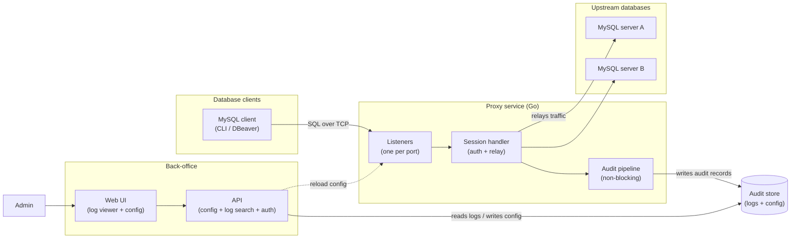

# Architecture — Starting Design

A first, simple view of the system. Detail will be added as the design firms up.

The system has two services that share one database:

- **Proxy** (the data path) — relays MySQL traffic and records audit events.
- **Back-office** (the control plane) — lets an admin review logs and manage config.

## How it flows

1. A client connects to the **proxy** on a port; each port maps to one upstream server.
2. The **session handler** authenticates, connects to the correct upstream, and **relays
   traffic both ways** — reading the queries as they pass.
3. Captured connections/queries go to the **audit pipeline**, which writes them to the
   **audit store** without slowing the live query path.
4. An **admin** uses the **web UI → API** to search the logs and manage config
   (which ports map to which servers). Config lives in the same store.
5. When config changes, the API signals the proxy to **reload** — new/changed ports only,
   without dropping unrelated live connections.
