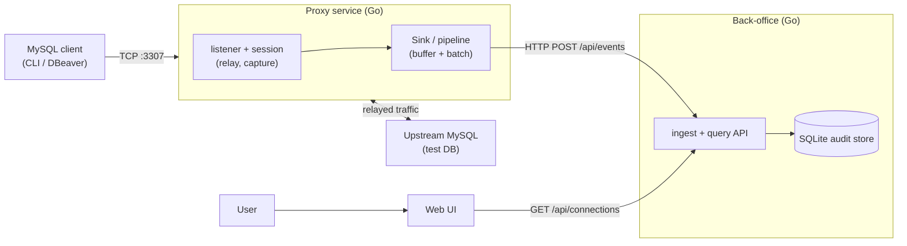

# Sprint 1 — Design & Plan

**Owner:** Tate · **Status:** draft (living — we keep it aligned as we build) · **Sprint window:** 27 Jul – 21 Aug 2026 · **Demo:** ~20 Aug

This is the plan for Sprint 1: what we're building, the decisions we're locking now (so we don't rework later), the contracts each part codes against, and the timeline. It's deliberately opinionated on the seams so the four workstreams can move in parallel without becoming isolated. Anything marked "propose" is open for the owner to refine; the locked decisions we change only by team agreement.

## 1. Goal

A working proxy that relays a client to a MySQL server on one port, captures the connections and queries, audit-logs them through a simple API into a test database, and shows them in a minimal web viewer — all running via `docker-compose`.

That's the whole Sprint 1 in one sentence: **a thin end-to-end slice of the real system.** Ugly is fine; connected and working is the point.

## 2. Scope

**In scope (MVP):**
- Proxy relays client ↔ one upstream MySQL on one (or a few) configured ports.
- Capture: connect, disconnect, and each query's SQL text; the connecting username.
- Audit events sent to an ingest API and stored in SQLite.
- API to list connections + statements.
- Minimal UI to view the log.
- `docker-compose` runs the whole thing; CI builds + tests it.

**Explicitly deferred (do NOT build in Sprint 1):**
- TLS / encryption handshake (both legs) — Sprint 2+.
- `caching_sha2_password` full/RSA exchange edge cases — use the simplest auth path that works locally.
- Runtime/API-driven config reload (hot-reload) — Sprint 3.
- Multiple upstreams as a managed feature, tamper-evidence (hash chain), RBAC/auth on the back-office, prepared-statement deep handling, normalised fingerprints, high-concurrency tuning, Postgres.

Keeping these out is what makes the demo achievable. If you're unsure whether something is in scope, it's probably not.

## 3. Success criteria (what the demo must show)

1. Point a MySQL client (CLI/DBeaver) at the proxy on a configured port.
2. It connects and relays to the real MySQL server; queries work normally.
3. A run of queries produces audit records (who / when / which server / the SQL).
4. Those records appear in the web UI, filterable by connection.
5. `docker-compose up` brings the whole system up from scratch.

If all five work, Sprint 1 is done — regardless of polish.

## 4. Architecture (Sprint 1 slice)



**The seam that matters:** the proxy never touches the audit DB directly — it POSTs events to the API, and only the back-office owns the store. This keeps the proxy decoupled from the schema and gives us one clear owner of the database.

## 5. Locked decisions (defined early on purpose)

These are the calls that cause rework if left fuzzy, so we fix them now.

| # | Decision | Choice | Why now |
|---|----------|--------|---------|
| D1 | Language | **Go** (proxy + back-office); `go-mysql` for the wire protocol | Locked (ADR-0001) |
| D2 | Repo structure | **Single Go module**: `/proxy`, `/backoffice`, `/internal`, `/web`, `/deploy` | Simplest for the team; avoids import pain |
| D3 | Audit store (MVP) | **SQLite** behind a `Store` interface | Zero setup; interface makes Postgres a later swap |
| D4 | Audit write path | Proxy pipeline → **HTTP POST to back-office API** → store | Only the back-office owns the DB; matches the kickoff; async keeps it off the query path |
| D5 | Config (MVP) | **Static YAML file** (port → upstream); no live reload yet | Runtime reconfig is a Sprint-3 feature |
| D6 | "Who" | **Username from the client handshake** | Enough for MVP; deeper attribution later |
| D7 | Encryption | **None in MVP** (trusted local/test network) | TLS deferred; design leaves room for it |
| D8 | Fail-safe rule | **Auditing never blocks/breaks a query** | If the sink/API is down: buffer, then drop-with-log — never error the client |
| D9 | Shared types live in | **`/internal/audit`** | One definition of the event everyone imports |

## 6. Components — responsibilities & Sprint 1 scope

**Proxy core** — *Joe + Mieke* (`/proxy`)
Accept a client connection via `go-mysql`'s server, capture the username from the handshake, dial the upstream from config, and relay traffic both ways. On the client→upstream path, detect `COM_QUERY` and emit a statement event; emit connect/disconnect events around the session. Depends only on the `Sink` interface — not on the API or DB.

**Audit sink / pipeline** — *Maria (Week 1)* (`/proxy` or `/internal/audit`)
Implement `Sink`: take events off the hot path via a buffered channel, batch them, and POST them to the back-office `/api/events`. Apply the fail-safe rule (D8). This is the glue between the proxy and the API — owning it means Maria learns the API contract, which sets her up to build the UI in Week 2.

**Ingest + query API** — *Keagan* (`/backoffice`)
Own the audit **data model** and the **API**. Accept batches at `POST /api/events`, write them via the `Store`. Serve `GET /api/connections` and `GET /api/statements` for the UI. Owns the only code that touches the DB.

**Store** — *Keagan* (`/backoffice`)
SQLite implementation of the `Store` interface + schema/migrations. In-memory stub of `Store` provided in scaffolding so the API works before the schema is final.

**Back-office UI** — *Maria (Week 2+)* (`/web`)
Minimal page(s): a connection/statement log viewer hitting the API, filterable by connection. Can start against the stub API's fake data anytime. Crude is fine (client said so).

**Infra / QA / glue** — *Tate* (`/deploy`, CI, scaffolding)
Scaffolding (module, interfaces, stubs), `docker-compose` (proxy + back-office + a demo MySQL + web), CI (build + lint + test green), Makefile, sample config. Keep the contract and board current; unblock people.

## 7. Contracts (the seams — agree these Day 1)

> These are **proposed**; Keagan owns the final shape of the model + API. We ratify in a 20-minute sync before everyone runs, then treat them as fixed for the sprint.

### 7.1 Shared event type — `/internal/audit`
```go
package audit

type Kind string
const (
    Connect    Kind = "connect"
    Statement  Kind = "statement"
    Disconnect Kind = "disconnect"
    AuthFail   Kind = "auth_fail"
)

type Event struct {
    ConnID     string    // groups events of one connection
    Kind       Kind
    User       string    // from the handshake
    ClientAddr string
    ProxyPort  int
    Upstream   string    // which upstream server
    DB         string    // default schema, if known
    SQL        string    // for Statement events
    StmtType   string    // SELECT/INSERT/... (best-effort)
    Err        string    // for AuthFail / errors
    At         time.Time
}
```

### 7.2 Interfaces (the plug points)
```go
// The proxy depends on this — not on HTTP or the DB.
type Sink interface { Emit(Event) }

// The API depends on this — SQLite now, Postgres later.
type Store interface {
    SaveEvents(ctx context.Context, evs ...Event) error
    Connections(ctx context.Context, f Filter) ([]Event, error)
    Statements(ctx context.Context, f Filter) ([]Event, error)
}
```

### 7.3 API (first cut)
| Method + path | Purpose |
|---------------|---------|
| `POST /api/events` | Ingest a batch of events (from the proxy sink) → `202` |
| `GET /api/connections?limit&offset` | List connections |
| `GET /api/statements?conn_id=&limit&offset` | List statements (optionally by connection) |
| `GET /api/servers` | Read the port→upstream config (for the UI) |
| `GET /healthz` | Liveness |

Request/response bodies are JSON arrays/objects of the `Event` shape. Keagan to pin exact fields in `docs/design/api.md`.

### 7.4 Config (first cut) — `deploy/config.yaml`
```yaml
listeners:
  - port: 3307
    upstream:
      host: demo-mysql
      port: 3306
      user: proxysvc
      password_env: UPSTREAM_PW   # secret via env, never in the file
backoffice:
  ingest_url: http://backoffice:8080/api/events
```

### 7.5 Data model (first cut)
- **connections**: `conn_id`, `ts_connect`, `ts_disconnect`, `client_addr`, `proxy_port`, `upstream`, `user`, `auth_result`
- **statements**: `id`, `conn_id` (FK), `ts`, `sql_text`, `stmt_type`, `db`, `err`
- **servers** (config mirror, mostly file-driven in MVP): `id`, `listen_port`, `upstream_host`, `upstream_port`, `user`

## 8. Data flow (end to end)
1. Client connects to the proxy on a configured port.
2. Proxy completes the handshake (captures **user**), dials the upstream from config, emits a **connect** event to the `Sink`.
3. Client sends a query → proxy forwards it, and emits a **statement** event (SQL text) to the `Sink`.
4. `Sink` buffers + batches events and POSTs them to `POST /api/events` (off the hot path).
5. API writes the batch via `Store` into SQLite.
6. On disconnect, proxy emits a **disconnect** event.
7. UI calls `GET /api/connections` / `GET /api/statements` and renders the log.

## 9. Repo / module layout
```
/proxy         # Joe + Mieke — listener, session, relay, capture
/backoffice    # Keagan      — API + Store + SQLite schema
/web           # Maria       — minimal log-viewer UI
/internal
  /audit       # SHARED      — Event type, Sink + Store interfaces
/deploy        # Tate        — docker-compose, config.yaml, CI helpers
/docs
Makefile       # make run / make test / make lint
```

## 10. Cross-cutting rules
- **Fail-safe auditing (D8):** the relay path must never return an error to the client because of an audit problem. Emit is non-blocking; the sink handles buffering/overflow/logging.
- **Depend on interfaces, not implementations:** proxy → `Sink`; API → `Store`. Use the provided stubs (in-memory `Store`, no-op/HTTP `Sink`) so nobody is blocked.
- **Config via file + env; secrets only via env** (never commit passwords).
- **Git workflow:** issue → draft MR before starting → keep MR description updated → review → merge; keep merged branches (see `CONTRIBUTING.md`).
- **Small vertical slices:** get the trivial end-to-end path working before deepening any one box.

## 11. Testing strategy (Sprint 1)
- **Unit:** the parser's command detection; the sink's batching + fail-safe behaviour; the store's save/query.
- **Integration:** `testcontainers` (or a compose-based test) spins up a real MySQL; assert the proxy relays a simple query without corrupting the result and that an event lands in the store.
- **Manual demo test:** the 5 success criteria in §3, run end-to-end via `docker-compose`.
- CI runs unit + build + lint on every push/MR.

## 12. Timeline & milestones

| When | Milestone |
|------|-----------|
| **Weekend (1–3 Aug)** | Scaffolding + contracts up; board populated; everyone set up + first commit; contract ratified in a short sync |
| **Week 1 (4–10 Aug)** | **Walking skeleton** — relay + connect/disconnect logging end-to-end (proxy → sink → API → SQLite → UI shows it), even if trivial |
| **Week 2 (11–17 Aug)** | **Query capture** — log the SQL; real SQLite store; UI viewer with per-connection filter; Maria on UI |
| **Week 3 (18–20 Aug)** | Integrate, tidy, write the missing tests, **rehearse the demo** (buffer time) |
| **~20 Aug** | **Client demo** |

**The key checkpoint is the end of Week 1:** if the pieces connect end-to-end (even trivially), the rest is filling boxes. If they don't, we swarm on integration.

## 13. Task breakdown → first issues
| Issue | Owner | Done when |
|-------|-------|-----------|
| Data model + API contract (`api.md`, types) | Keagan | Types + endpoints merged; team ratified |
| Scaffolding: module, interfaces, stubs, compose, CI | Tate | `docker-compose up` runs the stubbed system; CI green |
| Proxy: relay on one port + connect/disconnect events | Joe + Mieke | A client connects through the proxy; a connect row appears |
| Sink: buffered + batched POST to API (fail-safe) | Maria | Events reliably reach the API; query path never blocked |
| API + SQLite store: ingest + list endpoints | Keagan | Events persist; `GET /connections` returns them |
| Proxy: capture `COM_QUERY` SQL | Joe + Mieke | A run of queries shows up as statement rows |
| UI: minimal log viewer | Maria (Wk2) | Log visible + filterable by connection in the browser |

## 14. Open items to confirm
- **Module structure (D2)** — single module OK for everyone? (recommended)
- **Audit write path (D4)** — everyone happy the proxy goes through the API, not straight to the DB?
- **UI stack** — Maria's call; recommend keeping it minimal (plain HTML+fetch or a tiny Vite app).
- **Client test data** — following up with Acumen; until then we stand up our own demo MySQL in compose.

## 15. Deferred to later sprints (tracked, not forgotten)
TLS (both legs) · `caching_sha2` full/RSA path · runtime config reload · multiple managed upstreams · tamper-evident hash chain · back-office auth + RBAC · prepared-statement deep handling · normalised fingerprints · Postgres · high-concurrency tuning.
