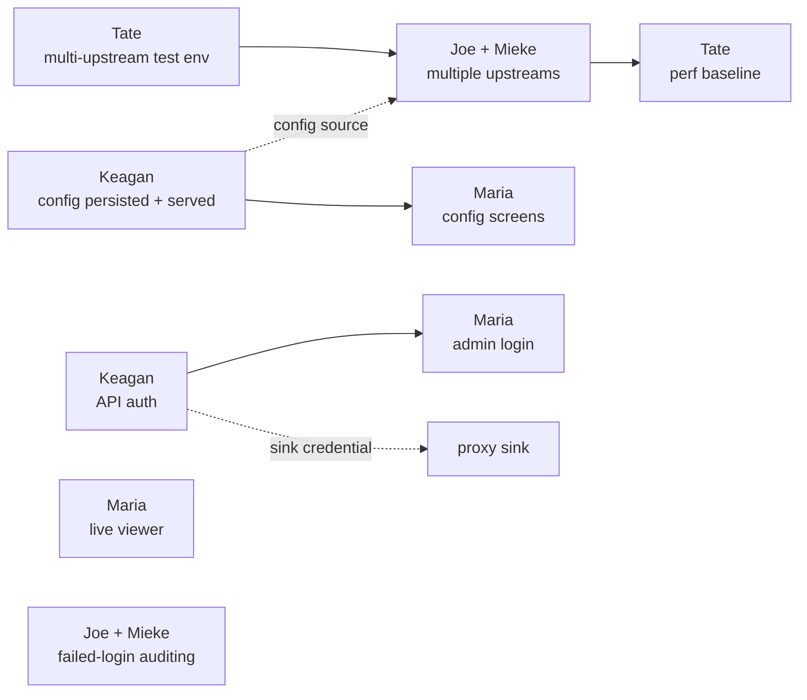

# Sprint 2 — Delegation

**Window:** 24 Aug – 25 Sep 2026 · **Demo:** Thu 24 Sep

Priority: **P1** must land · **P2** where the sprint is judged · **P3** if time allows.
Fill the issue numbers in as they're created.

## Maria — Back-office UI

| Task | Pri | Issue | Depends on |
|------|-----|-------|------------|
| Live-updating log viewer (poll or WebSocket) | P1 | # | — |
| Admin login screen | P2 | # | API auth |
| Configuration management screens | P2 | # | Config API |
| Surface failed queries clearly | P3 | # | — |

*Start with the live viewer — it's the only change the client explicitly asked for.*

## Keagan — Store + API

| Task | Pri | Issue | Depends on |
|------|-----|-------|------------|
| Persist + serve server configuration | P1 | # | — |
| Endpoints for editing configuration | P2 | # | above |
| Authentication on the API | P2 | # | — |

*Config work blocks Maria's screens. API auth blocks her login.*

## Joe + Mieke — Proxy

| Task | Pri | Issue | Depends on |
|------|-----|-------|------------|
| Failed-login auditing (`auth_fail` events) | P2 | # | — |
| Multiple upstream servers, routed by port | P2 | # | Multi-upstream test env |
| Prepared statements | P3 | # | — |
| MySQL 8 default authentication | P3 | # | — |

*Start on failed-login auditing — small and independent, so you're moving while the test
environment lands.*

## Tate — Infrastructure

| Task | Pri | Issue | Depends on |
|------|-----|-------|------------|
| Multi-upstream test environment | P1 | # | — |
| End-to-end tests in CI | P3 | # | — |
| Performance baseline (25–50 connections) | P3 | # | Multiple upstreams |

*Test environment first — Joe and Mieke are blocked on it.*

## Dependency graph

Nothing is more than two deep. `test env → multiple upstreams` is the longest chain, so the
test environment goes first.

**No dependencies, start immediately:** live viewer · failed-login auditing · config
persistence · API auth · test environment.

## Two coordination points

**Config source.** Keagan is moving configuration into the database; Joe and Mieke are adding
listeners that read configuration. Build multi-upstream against the **existing file config**
first; Keagan switches the source afterwards. Otherwise both change the same thing.

**API auth vs the audit sink.** When auth lands on `/api/*`, the proxy's sink gets 401s on
`POST /api/events` — and treats 4xx as permanent, so it **drops batches instead of retrying**
and auditing silently stops. Either leave `/api/events` open, or give the proxy a credential
and ship the sink change in the same merge.

## Order of work

1. Tate: test env · Maria: live viewer · Keagan: config persistence · Joe + Mieke: failed-login
2. Multiple upstreams (against file config) · API auth (with sink decided)
3. Config screens · admin login
4. If time: prepared statements · MySQL 8 auth · e2e tests · perf baseline
